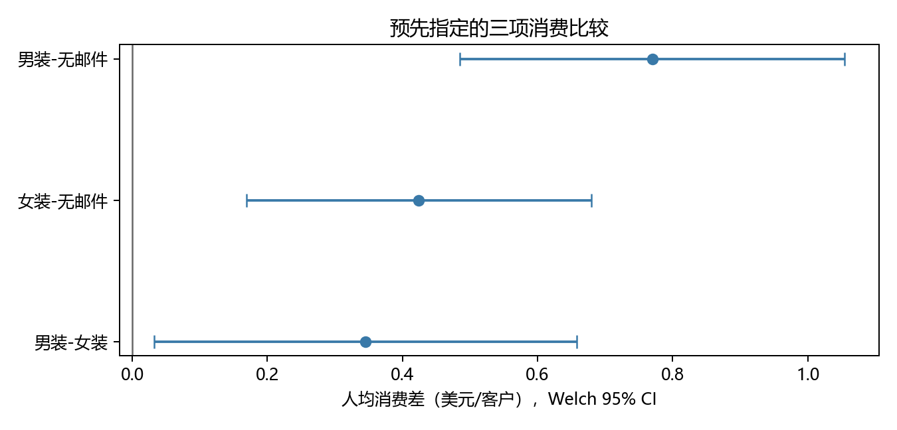
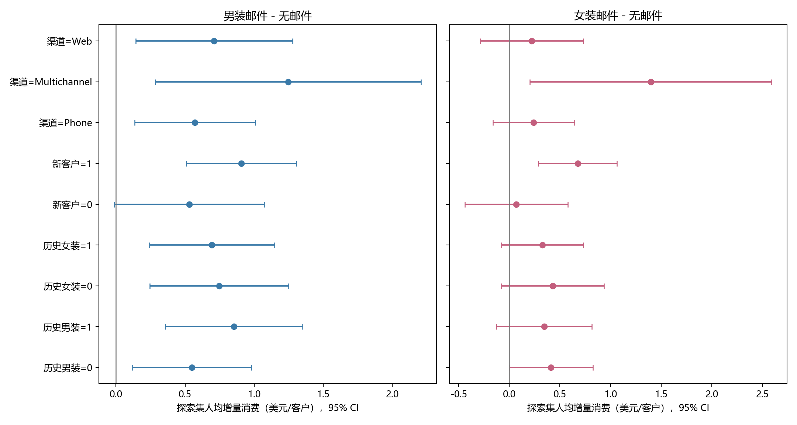
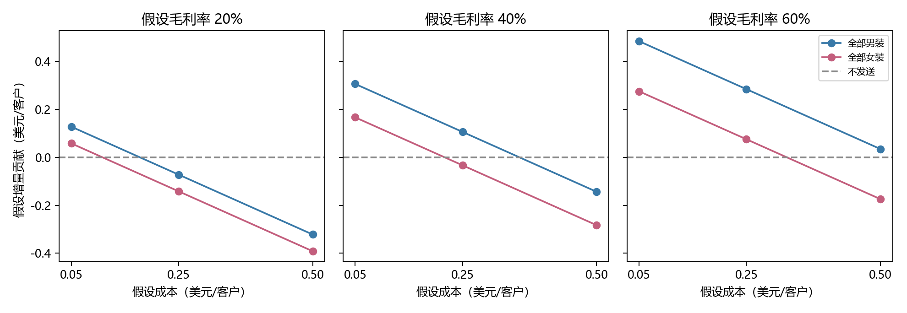

# Hillstrom 邮件营销随机实验：从增量消费到投放决策

以 **Python、Pandas、SciPy 和 NumPy** 完成的数据分析项目。围绕 Kevin Hillstrom 公布的邮件随机实验，依次审计原始数据、估计男装与女装邮件的增量消费、检验客户特征的处理效应差异，并在固定的内部验证集上复核三种全量投放策略。项目区分**消费效果的统计证据**与**假设成本下的经济性判断**。

## 业务问题与核心结论

面对近期购买客户，企业应该发送男装邮件、发送女装邮件，还是不发送？原始发布者称约 64,000 名客户被随机分入三组，邮件后观察两周。实际组数为男装 21,307、女装 21,387、无邮件 21,306。两种邮件相对不发送均有正向人均消费差；男装的点估计最高。**内部验证集不足以确认男装优于女装**，因此男装适合作为优先试点方案，同时保留女装与不发送对照，其优势不能视为已被证明。

第三阶段预定检验的 `mens`、`womens`、`newbie`、`channel` 四类客户特征，经 Holm 校正后均没有充分的整体交互效应证据。定向候选规则冻结为 `null`，不会因为个别子组点估计较高而制定定向发送策略。

## 数据来源与实验设计

数据来自 Kevin Hillstrom [2008 年 3 月 20 日的原始说明页](https://blog.minethatdata.com/2008/03/minethatdata-e-mail-analytics-and-data.html)。发布者描述约 1:1:1 分配至男装邮件、女装邮件、无邮件三组；实验前特征包括历史消费与购买渠道，结果包括两周网站访问、购买转化和消费额。项目从页面所指发布者域名取得原始 CSV，并保留文件内容不变。[来源与质量审计](docs/data_audit.md)记录了下载方式、字段、实际取值及核查边界。

主要指标是**全部被分组客户的两周人均消费**，零消费客户计入分母。全样本三项预定消费比较采用 Welch 方法与 95% 置信区间，三个 p 值用 Holm 校正；另做固定种子的分组内 Bootstrap。访问率与转化率作为辅助指标，六项比较单独成族校正。SRM 检查 χ²(2)=0.2025、p=0.9037；实验前特征最大两两绝对 SMD 为 0.0169。这些检查未发现明显分组异常，**不能证明**企业内部随机执行或邮件实际送达。[实验设计](docs/experiment_design.md)与[全样本效果报告](docs/experiment_effect_report.md)说明方法。

## 全样本增量效果

| 随机组 | 人数 | 网站访问率 | 购买转化率 | 两周人均消费 |
| --- | ---: | ---: | ---: | ---: |
| 男装邮件 | 21,307 | 18.2757% | 1.2531% | $1.4226 |
| 女装邮件 | 21,387 | 15.1400% | 0.8837% | $1.0772 |
| 无邮件 | 21,306 | 10.6167% | 0.5726% | $0.6528 |

| 人均消费比较 | 均值差（美元/客户） | Welch 95% CI | 原始 p | Holm p |
| --- | ---: | --- | ---: | ---: |
| 男装－无邮件 | +0.7698 | [0.4851, 1.0545] | 1.164×10⁻⁷ | 3.491×10⁻⁷ |
| 女装－无邮件 | +0.4244 | [0.1690, 0.6799] | 0.001129 | 0.002259 |
| 男装－女装 | +0.3454 | [0.0326, 0.6583] | 0.030469 | 0.030469 |

消费额含大量零值且标准差远高于均值；2,000 次 Bootstrap 区间与 Welch 区间方向一致。全样本男装－女装差达到本阶段阈值，但较小的内部验证集对该差异的估计更不确定，不能把两个结果当成独立实验重复证明优势。



## 用户异质性与内部验证

按原始行位置和 `segment` 分层、固定种子 `20261017`，将 64,000 条记录划为 **44,800 条探索集**和 **19,200 条验证集**。第三阶段仅用探索集研究四个预定实验前特征；包含全部特征及处理交互项的 OLS 模型使用 HC3 稳健协方差。四个整体交互检验的 Holm p 均为 **0.756808**，不足以支持基于这些特征制定定向规则。部分渠道子组仅有少量非零消费客户，详见[异质性报告](docs/heterogeneity_report.md)。



第四阶段在读取验证集消费结果前提交了[固定策略评估方案](docs/policy_evaluation_plan.md)：P0 不发送、P1 全部男装、P2 全部女装。验证集两周人均消费分别为 **$0.5151、$1.4062、$1.0578**。P1－P0 为 **+$0.8912**（Welch 95% CI [0.3561, 1.4263]，Holm p=0.003299）；P2－P0 为 **+$0.5427**（[0.1292, 0.9562]，Holm p=0.020198）；P1－P2 为 **+$0.3485**（[-0.2237, 0.9207]，Holm p=0.232594）。[策略决策报告](docs/policy_decision_report.md)列出探索集对照、Bootstrap 结果与分析限制。

**验证集是第二阶段已分析完整 64,000 条数据之后划出的内部留出样本，不是新的外部独立实验。** 它仅用于固定策略的内部稳定性复核，不能与全样本结果叠加为额外显著性证据。

## 假设经济性与建议

原始数据没有真实毛利率或邮件执行成本。项目仅展示明确标注的假设情景：`人均增量贡献 = 假设毛利率 × 相对不发送的人均增量消费 − 假设每客户邮件成本`；不发送设为零。以验证集点估计，假设毛利率 40% 时，男装和女装邮件的单客户盈亏平衡成本分别为 **$0.3565** 与 **$0.2171**；相应由普通消费差区间换算的门槛范围为 **[$0.1424, $0.5705]** 与 **[$0.0517, $0.3825]**。这些门槛存在明显不确定性，不能当成真实利润或 ROI。



在真实毛利、全流程成本和送达数据得到核实之前，**建议优先试点男装邮件，并保留女装与无邮件随机对照**。成本高于相应门槛时，不发送可能更合理；男装相对女装的实际经济优势仍需新实验确认。上线前还需要核实客户唯一性、随机执行、实际投递、结果追踪、长期效果和当前目标客户的适用性。公开数据没有唯一用户 ID；6,562 条全字段相同的后续记录没有被擅自删除。项目不计算真实 ROI 或实际利润提升。

## 从 GitHub 克隆后复现

需要 Python 3.10+ 与 PowerShell。原始 CSV **未纳入 Git**：再分发授权尚未核实，请从[原始说明页](https://blog.minethatdata.com/2008/03/minethatdata-e-mail-analytics-and-data.html)获取。预期文件名为 `Kevin_Hillstrom_MineThatData_E-MailAnalytics_DataMiningChallenge_2008.03.20.csv`，SHA256 为 `0e5893329d8b93cefecc571777672028290ab69865718020c78c7284f291aece`。项目使用的发布者原始地址在 2026-10-17 的 HTTP HEAD 核查中返回 200；未来若失效，应先核查来源，不要用模拟数据替代。

在项目根目录执行下列 PowerShell 命令，将原文件放在指定位置并核对哈希：

```powershell
New-Item -ItemType Directory -Force data/raw | Out-Null
$rawName = 'Kevin_Hillstrom_MineThatData_E-MailAnalytics_DataMiningChallenge_2008.03.20.csv'
$rawPath = Join-Path 'data/raw' $rawName
$sourceUrl = 'http://www.minethatdata.com/Kevin_Hillstrom_MineThatData_E-MailAnalytics_DataMiningChallenge_2008.03.20.csv'
curl.exe -fL --output $rawPath $sourceUrl
if ($LASTEXITCODE -ne 0) { throw '原始 CSV 下载失败' }
$actualHash = (Get-FileHash $rawPath -Algorithm SHA256).Hash.ToLowerInvariant()
$expectedHash = '0e5893329d8b93cefecc571777672028290ab69865718020c78c7284f291aece'
if ($actualHash -ne $expectedHash) { throw "原始 CSV SHA256 不匹配：$actualHash" }
```

安装依赖后，**依次**运行四阶段脚本：

```powershell
python -m pip install -r requirements.txt
./run_audit.ps1
./run_effect_analysis.ps1
./run_heterogeneity.ps1
./run_policy_evaluation.ps1
```

如使用虚拟环境，请先激活，再运行上述命令。每个脚本都会运行自动化测试；第四阶段会强制校验原始 CSV、固定划分索引和冻结方案的 SHA256，并核对冻结规则仍为 `null`、三种基准策略未变。

## 项目结构

```text
data/raw/                    原始 CSV，本地准备、Git 忽略
data/*.json                  四阶段结构化结果与划分记录
data/split_indices.npz       固定探索/验证行索引
src/                         审计、全样本效果、划分、异质性、策略评估代码
docs/                        数据审计、实验设计、各阶段报告与冻结方案
figures/                     分析图表
tests/                       数据约束、效应、交互、策略和哈希测试
run_*.ps1                    四阶段独立复现入口
requirements.txt             Python 依赖
```

项目重点是**可核查的增量消费分析与审慎决策**：原始数据可追溯、方案与结论分开冻结、零消费客户保留在分母、探索性异质性不冒充确定投放规律、成本情景不冒充真实经营结果。

## 补充：消费增长的描述性拆解

阅读 [2008 年获奖论文](https://www.stochasticsolutions.com/pdf/HillstromChallenge.pdf)后新增了[独立补充分析](docs/posthoc_analysis_report.md)。全样本核验 `人均消费=访问率×访问后购买率×购买者均消费`，并以 Shapley 对称会计分解解释总差结构。男装相对无邮件的三项会计贡献为 **+$0.5336、+$0.2404、-$0.0043**，女装为 **+$0.2997、+$0.0675、+$0.0572**。访问后购买和购买者均消费都由实验后行为筛选，不能据此识别独立的因果机制。[消费结构图](figures/spend_decomposition.png)与[论文对照](docs/reference_comparison.md)保留实际数值及原文差异；没有实现获奖论文的 Uplift 模型。

## 补充：历史消费与购买间隔的事后探索

仅在固定 **44,800 条探索集**新增 history 三层与 recency 四层分析。两项 OLS+HC3 联合交互检验的 Holm p 分别为 **0.021106** 和 **0.719379**：历史消费有探索线索，但稀少购买与宽区间不足以确立定向规则。该分析是在阅读论文后确定，区别于原四阶段已固定的问题与结果；没有利用验证集挑选新规则，没有改变第三阶段原四特征的检验、冻结的 null 规则或第四阶段结论。运行 `./run_posthoc_analysis.ps1` 可重建 `data/posthoc_results.json`、[历史消费图](figures/history_effects.png)、[recency 图](figures/recency_effects.png)并执行测试；[新增分组方案](docs/posthoc_analysis_plan.md)单独保存。
