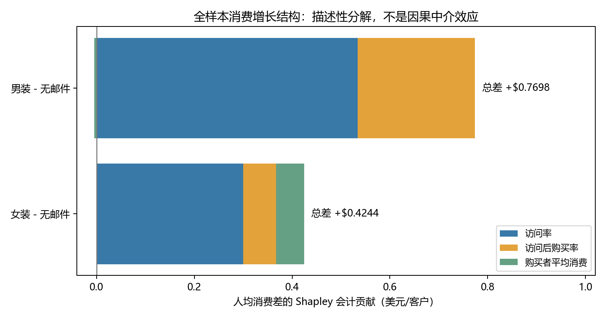
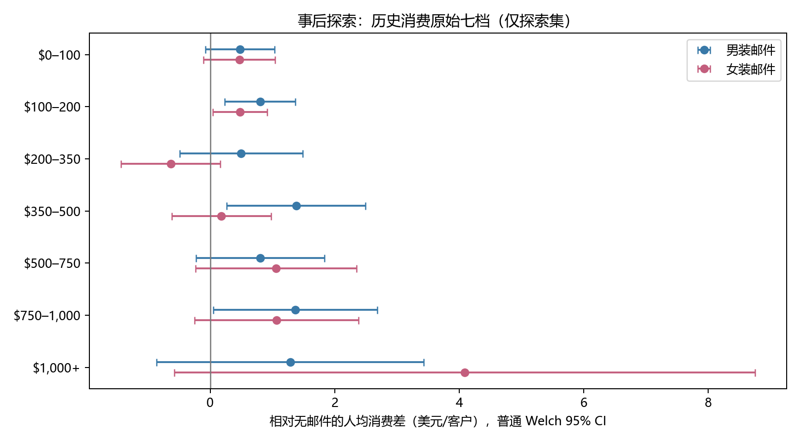
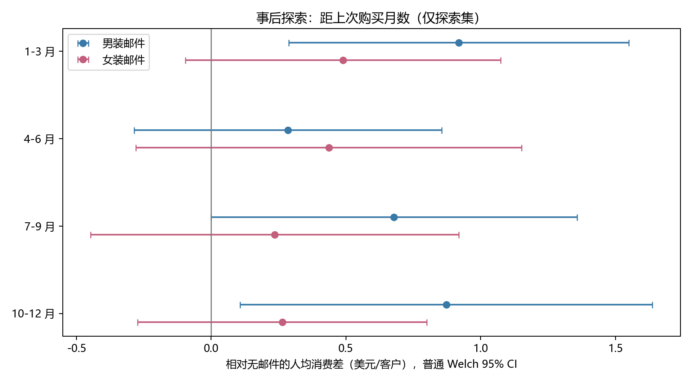

# 阅读历史获奖论文后的补充业务分析

本轮参考 [Stochastic Solutions 的 2008 年获奖论文](https://www.stochasticsolutions.com/pdf/HillstromChallenge.pdf)，补充消费增长结构和历史消费、购买间隔探索；没有实现其 Uplift Modelling。新增内容是**事后探索**，不改变原四阶段结果与冻结决策。分组和检验方法先写入 [补充方案](posthoc_analysis_plan.md)，再执行分析；不能因此将其称为阅读论文前的预注册。

## 1. 全样本消费增长结构

使用原始 64,000 条随机分组记录。下表三项条件指标分母不同：访问率以全部被分组客户为分母，访问后购买率以访问者为分母，购买者平均消费以购买者为分母。历史男装/女装购买字段不代表客户性别。

| 随机组 | n | 访问人数 | 购买人数 | P(Visit) | P(Conversion\|Visit) | E(Spend\|Conversion=1) | E(Spend) |
| --- | ---: | ---: | ---: | ---: | ---: | ---: | ---: |
| 男装邮件 | 21,307 | 3,894 | 267 | 18.275684% | 6.856703% | $113.526929 | $1.422617 |
| 女装邮件 | 21,387 | 3,238 | 189 | 15.140038% | 5.836936% | $121.894762 | $1.077202 |
| 无邮件 | 21,306 | 2,262 | 122 | 10.616728% | 5.393457% | $114.002705 | $0.652789 |

购买未访问、非购买却正消费、购买却非正消费、负或非有限消费等逻辑异常均为 0。因而三组均满足：

`E(Spend) = P(Visit) × P(Conversion|Visit) × E(Spend|Conversion=1)`。

精确计算残差绝对值最大为约 `1.11e-16`，只是浮点误差；计算使用未四舍五入数值。男装邮件组相对对照的访问率高 **7.658956 个百分点**，访问后购买率高 **1.463246 个百分点**，购买者平均消费低 **$0.475776**；女装邮件组对应为 **+4.523311 个百分点、+0.443479 个百分点、+$7.892057**。因此，男装的观测差异更集中在访问及访问后的购买比例，女装购买者的平均消费更高，但其全组人均消费增量仍低于男装。

**这些是描述性条件比较，不是已识别的因果机制。** 访问者与购买者均由实验后的行为筛选，三组条件人群的构成可能不同。不能据此说邮件通过某一独立中介机制产生了多少因果效果，也没有对上述条件指标宣称统计显著。

### 三因素 Shapley 对称会计分解

将三个因素从对照值替换为邮件组值，枚举全部 6 种替换顺序，平均每个因素的边际乘积变化。单位为美元/随机分组客户；正负贡献可相抵。

| 相对无邮件 | 访问率会计贡献 | 访问后购买率会计贡献 | 购买者均消费会计贡献 | 合计人均消费差 |
| --- | ---: | ---: | ---: | ---: |
| 男装邮件 | +0.533646 | +0.240436 | -0.004254 | +0.769827 |
| 女装邮件 | +0.299713 | +0.067496 | +0.057203 | +0.424412 |

按未舍入数值，贡献之和等于各自总差，求和残差为 0。访问率是两种邮件差额中最大的会计项；这取决于指定三因素乘法结构及对称分配约定，不能解释成自然直接效应或间接效应。

## 2. 固定探索集的新增分层

只使用第三阶段固定的 **44,800 条探索记录**：男装 14,915、女装 14,971、无邮件 14,914。分层读取解析 CSV 时跳过全部 19,200 条验证记录；全样本拆解读取只包含分组和结果列，没有向新增细分分析传递历史消费或 recency。本轮不计算新规则或验证集细分价值。

七个原始历史消费档只作描述；按方案将 1–2、3–4、5–7 档合为低、中、高三层做交互检验。recency 固定为 1–3、4–6、7–9、10–12 月。下表各实验组格式为 **人数 / 非零消费人数 / 人均消费美元**；差值均为邮件减无邮件，附普通、未做多重校正的 Welch 95% CI。

### 原始历史消费七档（描述性）

| 原档 | 男装组 n/非零/均值 | 女装组 n/非零/均值 | 对照组 n/非零/均值 | 男装－对照，95% CI | 女装－对照，95% CI |
| --- | --- | --- | --- | --- | --- |
| 1：$0–100 | 5,400 / 54 / 1.1623 | 5,330 / 41 / 1.1487 | 5,340 / 26 / 0.6811 | +0.4812 [-0.0725, 1.0348] | +0.4675 [-0.1045, 1.0396] |
| 2：$100–200 | 3,270 / 29 / 1.1187 | 3,287 / 27 / 0.7973 | 3,396 / 12 / 0.3173 | +0.8013 [0.2358, 1.3669] | +0.4799 [0.0462, 0.9137] |
| 3：$200–350 | 2,848 / 48 / 1.7841 | 2,894 / 18 / 0.6534 | 2,816 / 24 / 1.2859 | +0.4982 [-0.4904, 1.4869] | -0.6324 [-1.4279, 0.1630] |
| 4：$350–500 | 1,492 / 28 / 2.0820 | 1,577 / 13 / 0.8805 | 1,486 / 16 / 0.7003 | +1.3817 [0.2675, 2.4959] | +0.1802 [-0.6165, 0.9769] |
| 5：$500–750 | 1,116 / 18 / 1.5849 | 1,148 / 18 / 1.8380 | 1,138 / 9 / 0.7822 | +0.8027 [-0.2292, 1.8346] | +1.0558 [-0.2382, 2.3497] |
| 6：$750–1,000 | 459 / 11 / 1.6583 | 412 / 7 / 1.3550 | 440 / 2 / 0.2883 | +1.3700 [0.0547, 2.6853] | +1.0667 [-0.2510, 2.3843] |
| 7：$1,000+ | 330 / 7 / 2.0332 | 323 / 8 / 4.8313 | 298 / 3 / 0.7460 | +1.2871 [-0.8576, 3.4319] | +4.0853 [-0.5775, 8.7481] |

第 7 档女装差值很大，但女装组仅 8 名非零消费客户，对照仅 3 名，区间跨零且很宽。第 3 档女装差值为负也不能直接称为邮件伤害消费。这里的多行描述性区间未校正，不能按正负或是否跨零选择客户。

### 合并历史消费三层

| 合并层 | 男装组 n/非零/均值 | 女装组 n/非零/均值 | 对照组 n/非零/均值 | 男装－对照，95% CI | 女装－对照，95% CI |
| --- | --- | --- | --- | --- | --- |
| 低：原 1–2 档 | 8,670 / 83 / 1.1459 | 8,617 / 68 / 1.0146 | 8,736 / 38 / 0.5397 | +0.6061 [0.2024, 1.0099] | +0.4749 [0.0854, 0.8644] |
| 中：原 3–4 档 | 4,340 / 76 / 1.8865 | 4,471 / 31 / 0.7335 | 4,302 / 40 / 1.0836 | +0.8029 [0.0502, 1.5556] | -0.3501 [-0.9395, 0.2394] |
| 高：原 5–7 档 | 1,905 / 36 / 1.6803 | 1,883 / 33 / 2.2458 | 1,876 / 14 / 0.6606 | +1.0196 [0.2415, 1.7977] | +1.5851 [0.4282, 2.7421] |

三层合计分别 26,023、13,113、5,664 条，合计 44,800。女装相对对照的增量点估计呈非单调变化；高层相对低层高约 $1.1102，相对中层高约 $1.9352。男装高层相对低层高约 $0.4135。这些是组间增量点估计差，不是已经独立验证的个体处理效应。

### recency 四层

| 月数 | 男装组 n/非零/均值 | 女装组 n/非零/均值 | 对照组 n/非零/均值 | 男装－对照，95% CI | 女装－对照，95% CI |
| --- | --- | --- | --- | --- | --- |
| 1–3 | 5,243 / 87 / 1.8221 | 5,193 / 64 / 1.3932 | 5,187 / 49 / 0.9036 | +0.9185 [0.2873, 1.5497] | +0.4896 [-0.0955, 1.0746] |
| 4–6 | 3,267 / 34 / 0.9500 | 3,344 / 24 / 1.1021 | 3,320 / 21 / 0.6658 | +0.2841 [-0.2864, 0.8547] | +0.4362 [-0.2789, 1.1513] |
| 7–9 | 3,274 / 41 / 1.3183 | 3,239 / 20 / 0.8760 | 3,301 / 11 / 0.6400 | +0.6784 [-0.0006, 1.3573] | +0.2360 [-0.4469, 0.9190] |
| 10–12 | 3,131 / 33 / 1.3893 | 3,195 / 24 / 0.7806 | 3,106 / 11 / 0.5170 | +0.8723 [0.1073, 1.6373] | +0.2636 [-0.2731, 0.8003] |

各层合计 15,623、9,931、9,814、9,432，合计 44,800。点估计并非明确单调关系；不能据此认定某个购买间隔一定更适合某种邮件。

## 3. 探索性交互检验

对 history 三层与 recency 四层分别拟合 `spend ~ treatment + stratum + treatment:stratum`，无邮件和首层为参照；只包含各自分类分层，不同时加入连续 history 或其确定性分箱。使用 OLS、HC3 异方差稳健协方差、渐近 Wald χ² 联合检验全部交互项为零。两项检验统一 Holm 校正，α=0.05。

| 新特征 | 联合 χ² | df | 原始 p | 本轮两项 Holm p | 解释 |
| --- | ---: | ---: | ---: | ---: | --- |
| history 三层 | 13.1528 | 4 | 0.010553 | 0.021106 | 本次事后探索存在消费处理差异线索 |
| recency 四层 | 3.6838 | 6 | 0.719379 | 0.719379 | 未发现充分的整体交互证据 |

两项模型均可估计，未出现秩或协方差失败。history 的联合检验不是某个邮件、某两个特定子组对比的单独显著性声明；也不能由此声称高历史消费者应收到女装。两项 Holm 仅控制**本轮指定的两项检验族**，不涵盖过去全部分析、论文引导的特征选择及所有描述性子组比较。长尾、稀少购买、事后选择和缺少新独立验证，均限制解释。

原第三阶段四个预定特征的检验及其“未发现充分交互证据”结论完全保留。新 history 结果针对不同特征、不同模型和事后问题，不构成对旧结果的覆盖，也不改变 `candidate_rule=null` 或第四阶段策略比较。

## 4. 论文对照与面试表达

详见 [逐项论文比较](reference_comparison.md)。实际复现了总体差额的近似基准和式 (5) 的描述性拆解方向；发现论文表 2/7 的部分均值水平与当前 CSV 有差额，未调整数据使之吻合。论文的访问率分箱和模型分数与本轮探索集消费差不是同一估计量，未复现其高价值客户选择或 Uplift 模型。

面试可以说明如何将总体消费差拆为可核查的会计指标、发现并记录参考论文数值差异、使用固定探索集和交互检验审慎研究新特征。不能写成“识别出访问中介因果机制”“已验证高消费用户应定向投放女装”“复现获奖 Uplift 模型”或“新增分析产生真实利润”。

## 复现与保存边界

在项目根目录运行 `./run_posthoc_analysis.ps1`，会检查原始 CSV 与固定索引哈希，输出 `data/posthoc_results.json` 及三张新图，并运行全部原有与新增测试。分析代码只读取旧产物，不重建或覆盖旧结果、分割、冻结规则和旧报告。没有使用验证集进行新特征的筛选或新规则评估；没有修改 Git 历史、邮箱或远程仓库。
